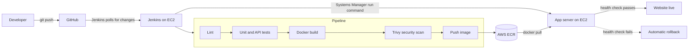

# Dockside: a CI/CD pipeline on AWS

Dockside is a small task tracker website that is **built, tested, scanned and deployed
automatically**. Push a change to GitHub and, a few minutes later, it is live on an EC2
server, with no one logging in to copy files. The whole AWS setup is created and removed
with Terraform.

The app is deliberately simple. The project is about the pipeline around it.

## How it works



1. **Lint and test**: syntax check and automated tests (store, API, website serving); GitHub Actions runs these on pushes and pull requests.
2. **Docker build**: the image is stamped with the build number and commit, which the
   website shows in its "How this page got here" panel.
3. **Trivy scan**: the build fails if the image has a fixable CRITICAL vulnerability.
4. **Push to ECR**: the image is stored in a private AWS registry.
5. **Deploy**: Jenkins tells the app server to pull the new image through AWS Systems
   Manager (no SSH keys stored in Jenkins). The server swaps the container, checks
   `/health`, and **rolls back to the previous image if the check fails**.
6. **Verify**: Jenkins confirms the live site reports the new build number.

## What is in the box

| Part | Details |
|---|---|
| Website | Task tracker UI in plain HTML, CSS and JavaScript with a live deployment panel |
| API | Node.js 22, zero dependencies, saves tasks to a file that survives redeploys |
| CI/CD | Declarative `Jenkinsfile`, JUnit test reports, SCM polling |
| Containers | `Dockerfile` with a non-root user and a health check |
| Infrastructure | Terraform: 2 EC2 servers, ECR repository, IAM roles, security groups |
| Security | EC2 instance roles, IMDSv2, encrypted disks, Trivy image scanning, non-root/read-only container, app administration through SSM, Jenkins UI and SSH limited to your IP |

## Project structure

```
aws-cicd-pipeline/
├── public/              # Website (index.html, style.css, app.js)
├── src/                 # Server: routes, task store, startup
├── test/                # Automated tests
├── scripts/
│   ├── deploy.sh        # Runs on the app server: pull, swap, health check, rollback
│   └── check-syntax.js  # Dependency-free lint step
├── terraform/           # All AWS infrastructure
│   └── user_data/       # First-boot setup scripts for both servers
├── docs/SETUP.md        # Step-by-step guide from zero to a live site
├── Jenkinsfile          # The pipeline
├── Dockerfile
└── README.md
```

## Run it on your laptop

Requires Node.js 22.x.

```bash
npm run lint
npm test
npm start          # http://localhost:3000
```

## Deploy it to AWS

Follow [docs/SETUP.md](docs/SETUP.md). In short:

```bash
cd terraform
cp terraform.tfvars.example terraform.tfvars   # add your IP and key pair name
terraform init
terraform apply
```

Then open the Jenkins URL from the Terraform output, create one pipeline job that points
at the existing GitHub repository, and push a change. See [docs/SETUP.md](docs/SETUP.md) for details.

When you are done, remove everything with one command:

```bash
terraform destroy
```

## Try the rollback

1. On a temporary branch, introduce a controlled startup failure in `src/server.js` and push it. Do not use this on a shared/demo deployment.
2. Prefer adding a dedicated test for the failure scenario; the regular tests validate API behavior but do not prove every runtime failure path.
3. The new container crashes, the health check fails, and the deploy script restores the
   previous version. The build turns red, and **the website stays up**.

## Security notes

- Never commit `terraform.tfvars`, `*.tfstate` or `.pem` files. `.gitignore` excludes them.
- Jenkins and SSH are reachable only from the IP address you set in `my_ip_cidr`. If your
  IP changes, update the variable and run `terraform apply`.
- The demo website uses plain HTTP on port 80 and has no user authentication; do not use it for sensitive or real customer data. For a public production deployment, put an HTTPS endpoint (for example an ALB with ACM) in front, add authentication/authorization, centralize logs/metrics, and configure remote Terraform state with locking and backups. The app server no longer exposes SSH; use AWS Systems Manager. Jenkins is still HTTP on port 8080 and should be restricted to a trusted network or placed behind TLS before extended use.
- The app server and Jenkins server have public IPs that change if you stop and start them.

## Validation boundaries

Passing local tests and GitHub Actions does not prove that AWS resources, IAM permissions, Jenkins bootstrap, SSM registration, ECR access, or live deployment work in your account. Run `terraform plan`, inspect it, deploy in a controlled account, and verify the complete pipeline before describing it as end-to-end verified. Terraform currently uses local state by default; configure a dedicated S3 backend with state locking before team use.

## Cost

Two small EC2 instances, two disks and an ECR repository. A few hours of use costs very
little, but charges continue until you run `terraform destroy`. Check current prices on
the AWS pricing pages.

## Troubleshooting

| Problem | Fix |
|---|---|
| Jenkins page does not load right after `terraform apply` | First boot takes 5 to 8 minutes. Follow it with `tail -f /var/log/user-data.log` over SSH |
| Jenkins page stopped loading later | Your IP changed. Update `my_ip_cidr` and run `terraform apply` |
| Deploy stage fails with `InvalidInstanceId` | The app server is still registering with Systems Manager. Wait a few minutes and run the build again |
| Build stuck on "Waiting for next available executor" | Jenkins takes itself offline when disk space is low. Check `df -h /` |
| `docker: permission denied` in a stage | `sudo usermod -aG docker jenkins && sudo systemctl restart jenkins` |
| Trivy fails the build | A fixable CRITICAL vulnerability was found. Update the base image tag in the `Dockerfile` |

## License

MIT. See [LICENSE](LICENSE).
